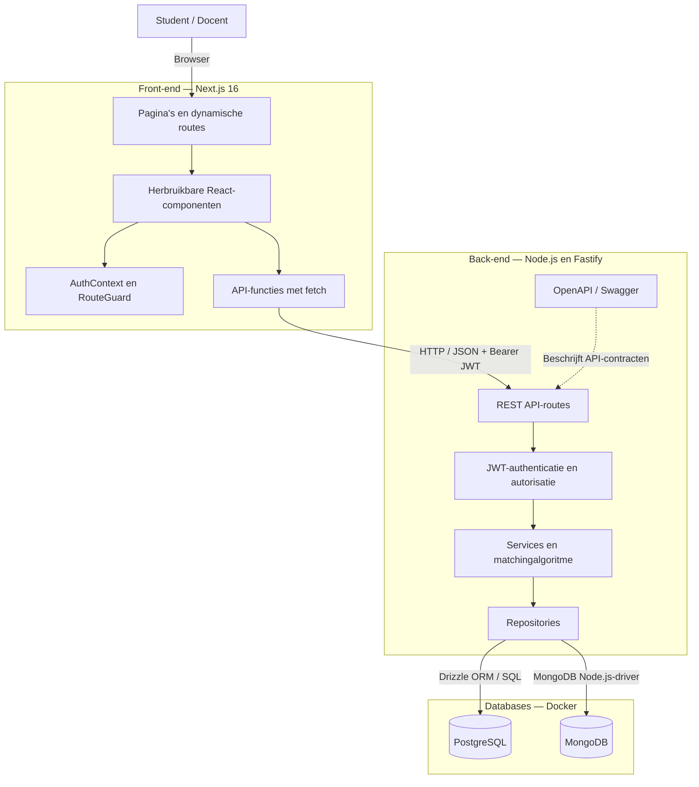
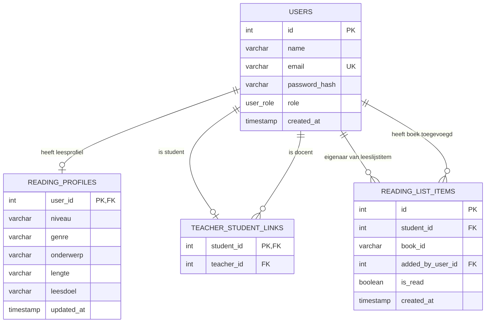

# Architectuur — Vrij lezen op maat

## 1. Systeemarchitectuur

### Verantwoordelijkheden

**Next.js en React**
- Tonen de catalogus, het leesprofiel, leesadvies en de leeslijsten.
- Gebruiken herbruikbare componenten zoals BookCard.
- Beheren lokale formulier- en laadstatus met React-state.
- Beheren de gedeelde gebruikerssessie via AuthContext.
- Gebruiken client-side routing, inclusief dynamische studentroutes.

**Fastify**
- Biedt REST-endpoints aan via HTTP en JSON.
- Controleert JWT-tokens en gebruikersrollen.
- Controleert of docenten daadwerkelijk aan studenten gekoppeld zijn.
- Verwerkt requests via routes, services en repositories.

**PostgreSQL**
- Bewaart gebruikers, leesprofielen, docentkoppelingen en leeslijstitems.
- Bevat de relationele gegevens en bijbehorende constraints.
- Wordt via Drizzle ORM benaderd.

**MongoDB**
- Bewaart de catalogus met 183 leesmaterialen.
- Bevat titels, auteurs, beschrijvingen en beschikbare metadata.
- Wordt via de officiële MongoDB Node.js-driver benaderd.

### Communicatie

De browser communiceert via HTTP met de Fastify-API.

Bij beveiligde requests wordt een JWT meegestuurd via:

Authorization: Bearer [token]

Fastify verifieert het token en controleert waar nodig de rol
en de docent-studentrelatie.

De front-end praat niet rechtstreeks met de databases.

### Back-endarchitectuur

We gebruiken een gelaagde architectuur:

Route → Service → Repository → Database

- Route: HTTP-request, validatie en autorisatie.
- Service: bedrijfslogica en het combineren van gegevens.
- Repository: queries naar PostgreSQL of MongoDB.

De matchingfunctie voor leesadviezen staat los van de databases.
Daardoor kan deze functie met unit tests worden getest.

### Front-endarchitectuur

We gebruiken de Next.js App Router en React-componenten.

- app/: routes en pagina's.
- components/: herbruikbare interface-onderdelen.
- context/: gedeelde authenticatiestatus.
- lib/: API-functies en gedeelde types.

Lokale state wordt gebruikt voor formulieren, filters en loading.
AuthContext wordt gebruikt voor gedeelde sessiegegevens.

Er is geen aparte state-managementlibrary nodig voor deze PoC.

## 2. ERD — PostgreSQL

### Relaties

**users → reading_profiles**
Een gebruiker kan maximaal één leesprofiel hebben.
Leesprofielen zijn bedoeld voor studenten.

**users → teacher_student_links**
Een student kan maximaal één gekoppelde docent hebben.
Een docent kan meerdere studenten begeleiden.

**users → reading_list_items**
Een student kan meerdere boeken op de leeslijst hebben.

**reading_list_items.added_by_user_id**
Dit verwijst naar de gebruiker die het boek heeft toegevoegd.
Dat kan de student zelf zijn of een gekoppelde docent.

**reading_list_items.book_id**
Dit bevat het ID van een catalogusboek in MongoDB.

Omdat PostgreSQL en MongoDB aparte databases zijn, is book_id
geen gewone PostgreSQL-foreign key naar een boektabel.
De back-end controleert daarom of het catalogusboek bestaat.

### Constraints

- Een e-mailadres is uniek.
- Een student heeft maximaal één leesprofiel.
- Een student heeft maximaal één docentkoppeling.
- Een student kan hetzelfde boek niet twee keer toevoegen.
- De back-end controleert dat een docent uitsluitend toegang
  heeft tot daadwerkelijk gekoppelde studenten.

## 3. Bewuste ontwerpkeuzes en beperkingen

### Twee databases

We gebruiken PostgreSQL voor relationele gegevens en MongoDB
voor catalogusdocumenten.

Voordeel: beide soorten gegevens kunnen op een passende manier
worden opgeslagen.

Nadeel: er zijn twee databaseverbindingen nodig en relaties
tussen beide databases moeten in applicatiecode worden gecontroleerd.

### Authenticatie

JWT beschermt de API. De RouteGuard verbetert de gebruikerservaring,
maar echte autorisatie wordt altijd in Fastify afgedwongen.

### Leesadviezen

De adviezen worden berekend met een deterministisch
matchingalgoritme op basis van profielvoorkeuren en catalogusgegevens.

De catalogusmetadata is niet volledig:
- 55 van 183 titels hebben een afgeleide genrecategorie.
- 4 van 183 titels hebben een gecontroleerde lengtecategorie.

Bij ontbrekende metadata worden geen extra matchpunten toegekend.

### Hosting en ontwikkeling

De applicatie draait lokaal:
- Next.js op poort 3000.
- Fastify op poort 3001.
- PostgreSQL en MongoDB via Docker Compose.

Dit is een lokale proof of concept, geen productieomgeving.
